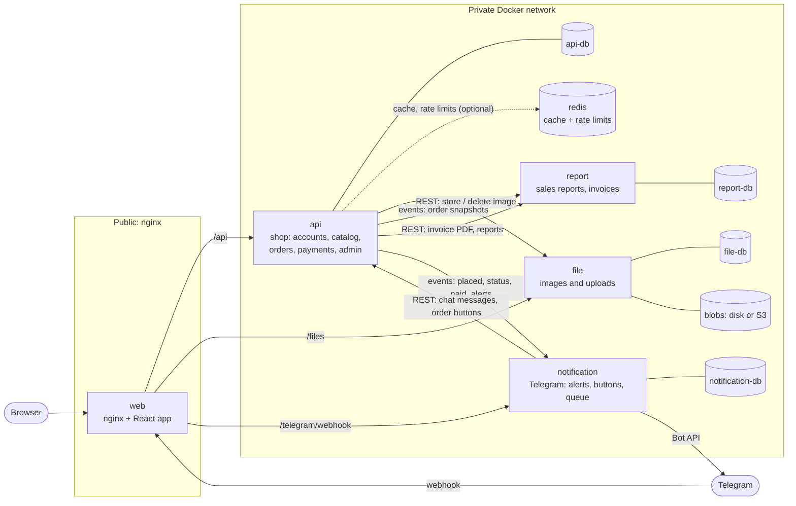
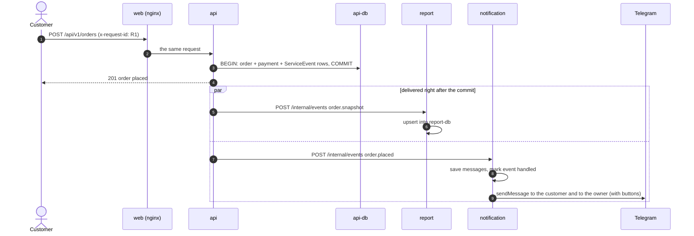
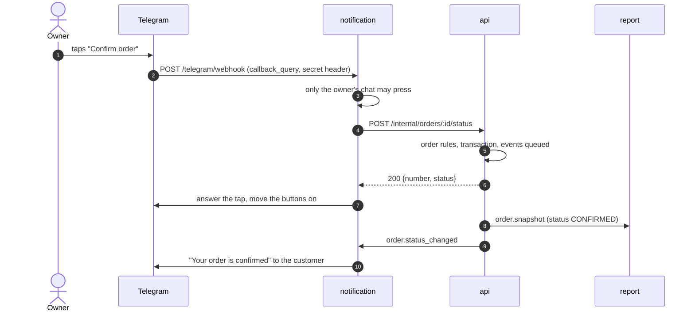

# Architecture

Cambo Supply is an online shop for keyboards and desk accessories in Cambodia. This document explains how it is divided
into services, what each one owns, and how they talk to each other. (It is also the architecture section of the project
report.)

## The services

| Service | Responsibility | Why it is separate | Owns |
|---|---|---|---|
| `api` | Accounts and sessions, catalog, pricing, orders, KHQR payments, admin screens' data | It is the business core: orders and money must stay in one transaction | `api-db`: users, products, orders, payments, promos |
| `file` | Resize and store images, serve them with long cache headers | CPU-heavy image work and storage (disk or S3) with a different scaling and failure profile | `file-db`: a record of every stored asset; the blobs themselves |
| `report` | Sales summaries, top products, the sales report PDF, CSV export, invoice PDFs | Headless Chrome for PDFs is heavy, and reporting must not slow down checkout | `report-db`: a copy of the order facts it needs |
| `notification` | Everything Telegram: message queue, retries, rate limits, new-order alerts, the owner's order buttons, the bot webhook | A third-party that is often slow or down must never block an order. Customers' and the owner's messages are one concern | `notification-db`: queued/sent messages, events already handled |
| `web` | The React app and the single public entry point (nginx) | Static files and routing | nothing |

Two small libraries are shared at build time, not at run time: `@cambo/shared` (business rules and the event contracts)
and `@cambo/service-kit` (logger, metrics, request ids, migrations). Services share code, never a database.

## How services communicate

1. **REST under `/internal`**, authenticated with a per-service bearer secret, only on the private network (nginx never
   routes `/internal` or `/metrics`):
   - api → file: store and delete images;
   - api → report: invoice PDFs and sales reports (the browser asks the api, the api asks report);
   - notification → api: a chat message that needs accounts or orders (`/internal/telegram/updates`) and the owner's
     order buttons (`/internal/orders/:id/status`);
   - api → notification: status and "send a test message".
2. **Events from the api to report and notification.** Defined once as zod schemas in `shared/src/events.ts`:
   `order.snapshot` (to report), and `order.placed`, `order.status_changed`, `payment.confirmed`, `payment.expired`,
   `admin.alert` (to notification).

### Why events, and how they stay reliable

The shop must keep selling when Telegram, the report service or the notification service is down, and none of them may
lose what happened. So:

- The api writes the event into its own `ServiceEvent` table **in the same database transaction as the change** (the
  order, the status change, the payment). Either both exist or neither does.
- After the commit the api delivers it immediately. A worker retries failures with backoff (5 s, 15 s, 45 s … 15 min,
  12 tries ≈ 2.5 h). If one service is down, events for the other still flow.
- Delivery is **at least once**, so receivers are idempotent:
  - `report` keeps the newest snapshot of each order (it compares `emittedAt`), so late, repeated or out-of-order events
    change nothing wrong;
  - `notification` records each event id it handled and de-duplicates each message by a key such as
    `order:<id>:customer:CONFIRMED`.
- An event the receiver rejects for good (a broken contract, a clashing order number) is marked failed at once, raises an
  alert, and can be queued again with `events retry-failed` once fixed.

When the owner taps **Confirm** under the alert:

## Data ownership

- No service connects to another service's database. `report` used to read the api's tables through a read-only login;
  it now keeps its own copy of the order facts it needs (`orders`, `order_items`), filled by `order.snapshot` events. A new
  or rebuilt report database catches up with `events backfill`.
- `file` records each stored asset in `file-db` and undoes an upload if it can't record it, so the registry never lies.
- Each service migrates its own database on start (Prisma for the api, plain SQL files and a small runner in
  `service-kit` for the others; an advisory lock makes two starts at once safe).

## Request tracing

Every request carries an `x-request-id` (nginx makes one if the browser did not). Each service puts it on every log line,
forwards it on every call it makes, and stores it with every event and every queued message. One customer action can
therefore be followed through nginx, the api, the report service and the notification service in the logs.

## Failure behaviour

| What fails | What happens |
|---|---|
| Telegram is down or rate limits | Messages stay queued in `notification-db` and are retried; orders are unaffected |
| `notification` is down | The api keeps the events (`service_events_pending{target="notification"}` climbs) and delivers them when it is back |
| `report` is down | Orders and payments are unaffected; its events wait; reports and invoices say "unavailable" until it is back |
| `file` is down | Product photos can't be uploaded; the shop keeps selling (images already stored are served by nginx → file; a CDN in front hides this) |
| Redis is down | The shop keeps working and reads PostgreSQL instead (a little slower); rate limits are not enforced until it is back. Nothing is lost: Redis holds only copies |
| `api-db` is down | The api reports not ready and the shop is unavailable (it is the source of truth) |
| A bad deploy of one service | The others keep running; each has its own health check and rollback by image tag |
